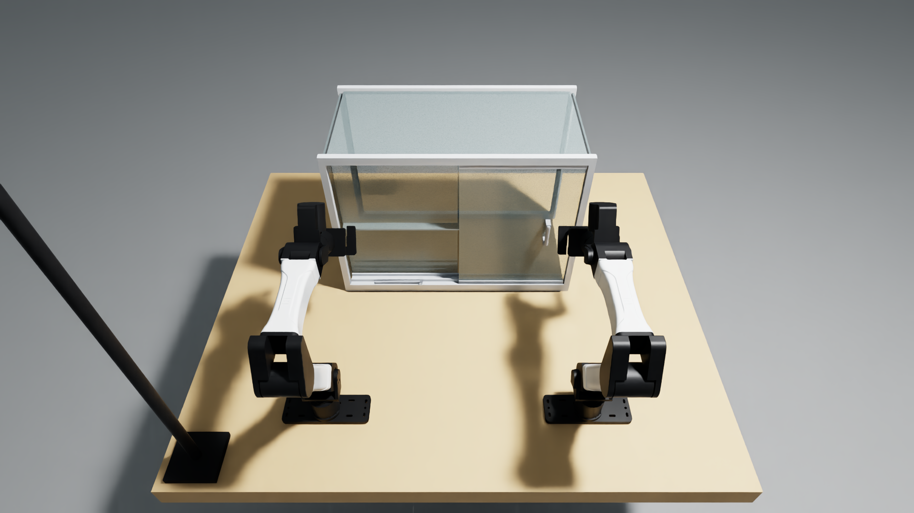

# Open a glass display cabinet with a loose key obstructing its track

Clear the loose L-shaped metal key from the sliding pane's path and open the front glass door. Keep the key inside the disclosed work area. Any physically valid strategy counts; the expert uses the left hand for the key and the right hand for the door.



## Layout, assets and limitations

`task.json` contains the exact model instruction, fixed setup, scoring, reset and action budget. `geometry.json` contains every authored part and mass/inertia assumption. `build_scene.py` generates the task USD assets from primitives and the two included convex hex-key meshes; there are no external task meshes or textures to download. The included MIT license covers the original task geometry and port code. Robot and station assets come from the pinned YAM dependency.

The cabinet is an independently authored countertop display, with a 609.6 x 304.8 mm frame-centre footprint and 625.6 x 320.8 x 457.2 mm outer frame. A 4.76 x 290 x 390 mm glass pane moves in a passive 290 mm slide. A 57 g L-key lies loose in its lower channel. This is a rigid simulation: glass is unbreakable, the rail cannot deform, and nominal masses, friction and damping are uncalibrated. The guide joint deliberately prevents an unphysical lift-and-replace solution. The scorer latches key loss and apparatus/guide errors rather than permitting them to be repaired for credit.

The full-scale counterpart reference is a countertop glass showcase, rather than a wardrobe. No manufacturer CAD, photographs or calibrated commercial mechanism are claimed. The source apparatus dimensions were inspired by the Displays2go CNTDGL24 format; the procedural geometry is our own. `ORIGIN.json` records source hashes. Physics, reset, geometry and evaluator are retained from the previously recorded native task. The instruction now explicitly states the existing work-area bounds, aligning the wording with the scorer; the mechanism/scorer AST is unchanged.

## Run and record

Use the configured Isaac Sim 6.1 / Isaac Lab-Arena environment with Python 3.12. The tested installed packages are Isaac Sim 6.1.0.0, Isaac Lab 17.0.2, Isaac Lab-Arena 0.3.0, YAM-Arena 0.1.0 and Inspect Robots 0.60.0. The recorded Isaac Lab source revision is `91a0906f93802eb859192dcb0bca879f891e92d6`. `pyproject.toml` pins the YAM source and optional Dream client dependencies.

From this task folder:

```bash
python -m pip install -e '.[dream]'
export PYTHONPATH="$PWD"
# Accept NVIDIA's license before setting this variable.
export OMNI_KIT_ACCEPT_EULA=YES

# Original scripted feasibility controller; no hosted inference.
OPENBLAS_NUM_THREADS=1 python tools/run_trial.py . /absolute/path/on/nvme/fresh-demo \
  --policy scripted --device cpu --seed 0 --width 1920 --height 1080

# Hosted Dream-1. Configure DREAM_API_KEY privately in the environment.
OPENBLAS_NUM_THREADS=1 python tools/run_trial.py . /absolute/path/on/nvme/fresh-dream \
  --policy dream --device cpu --seed 0 --width 1920 --height 1080
```

Use fresh output directories outside this task folder, preferably on NVMe. Select an available GPU with `CUDA_VISIBLE_DEVICES`. `--device cpu` selects native CPU PhysX; rendering uses RTX. Physics runs at 240 Hz and control/video at 20 Hz. The budget is 440 controls / 22 simulated seconds, including the model's camera-window preroll and the 1-second full-score hold. Reset settles 0.5 seconds before scoring. Seed 0 has no object jitter. The historical scripted demo completed in 342 controls / 17.10 simulated seconds and took 214.68 seconds to render at 1080p; actual hosted runtime includes network/inference delays and is reported in its receipt.

The runner writes native H.264/yuv420p video, setup/final PNGs, action/object/scoring traces, timing, an executed source snapshot and `receipt.json`. Dream additionally writes its request transcript. Dream receives the top and two wrist images at 320 x 176, the 14-D measured robot state, and the exact instruction. The 1080p recording reads native camera buffers. Privileged object poses and scorer values belong exclusively to the evaluator and local evidence. Dream actions use standard Inspect Robots bounds/delta guards, with raw and approved commands retained. No expert refinement is applied to Dream.

A valid completed task failure has `receipt.status=completed` and its measured partial/zero score. An API, measurement or simulator error is an incomplete diagnostic, not a completed model failure. `source_unchanged` verifies that files did not change during the run. The scripted and Dream policies use the same scene/reset/evaluator.

## Score and reproducibility

The exact numeric rubric is in `task.json` and `task.py`. Full score requires 280 mm opening, door and key speeds below 20 mm/s, and one continuous second of valid state. Partial credit is 0.25 at 50 mm and 0.5 at 140 mm. The specified key-volume and apparatus/guide failures latch zero. Native nonfinite or invalid pose measurements invalidate the recording. The runtime retains the previous partial score during the full-score hold.

The earlier independent uncleared-track native control kept the key and remained valid for 360 controls, reached only 169.20 mm opening and score 0.5. Removing the key with the reference controller reached 288.23 mm and full score. This supports the obstruction mechanism for the fixed layout; force calibration and robustness to parameter changes remain unmeasured.

A short native reset check makes no Dream call:

```bash
python tools/run_trial.py . /absolute/path/on/nvme/fresh-smoke \
  --policy hold --max-steps 20 --device cpu --seed 0 --width 640 --height 360
```

## Submission status

Native Dream evaluation, matching full-score demo and media-format checks are complete; results are recorded below. The model video, full-score demo and scored-reset screenshot were uploaded with the repository's `tools/upload_media.py` as **M-RVFJV7**, recorded in `task.json.media`. Eligibility and acceptance remain for the reviewers to determine.

## Completed native submission runs

The packaged scripted run completed with **score 1.0**, 342 controls / 17.10 simulated seconds and 288.23 mm door opening. The key was released on the bench, and its speed was 0.111 mm/s. Execution/recording took **249.37 seconds**.

The hosted `dreamlabs/dream-1-beta` run completed the full **440 controls / 22 seconds**, scoring **0.0**. The door opened only **0.0597 mm** and the key stayed at its starting location. All native states remained valid. The first 32 controls filled the camera window; 408 subsequent controls played model-returned rows. Dream returned **9 chunks over 17 API attempts with 8 session renewals**. The standard SDK retried expired sessions while retaining the client observation window. No expert action refinement or object-state input was supplied to Dream. This is a completed renewed-session evaluation, not a claim of a stable uninterrupted session. Execution, network waits and recording took **338.44 seconds**.

Both runs used identical instructions and task fingerprints. Their native reset object states matched exactly, and executed sources were unchanged during both trials. After recording, only result text, provenance labels and the setup image were updated; the current Python code and geometry still match the executed snapshots. The scorer and mechanism class remain identical to the historical native task.

Both recorded top videos are native **1920 x 1080, H.264/avc1, yuv420p, 20 fps**, with fast-start MP4s and successful full-stream decoding. Dream: **441 frames, 22.05 seconds, 3.63 MB**. Demo: **343 frames, 17.15 seconds, 3.71 MB**. The setup screenshot is below 10 MB and comes from the scored Dream reset.

The retained run-directory names are `sliding-track-submission-dream1-1080p-01` and `sliding-track-submission-demo-1080p-01`; each includes a native receipt, per-control traces and the executed source snapshot. These results demonstrate fixed-layout feasibility and a measured model failure for seed 0, rather than broad robustness. The uploaded media set is **M-RVFJV7**.

Run `python test_contract.py` to check local metadata and source consistency; `python test_contract.py --ready` additionally requires the real uploaded media ID.
