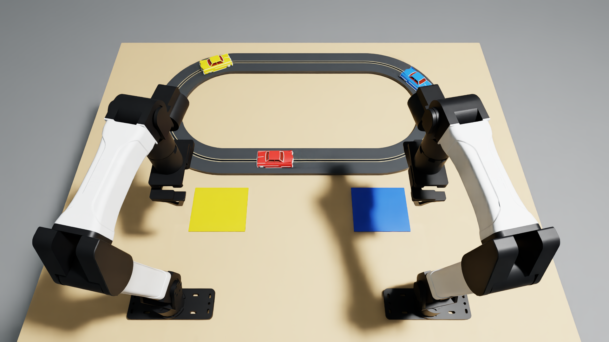

# Collect two moving slot cars without interrupting the race

Native Isaac Sim adaptation of https://github.com/robocurve/benchmark-tasks/pull/824, pinned source revision in ORIGIN.json. Retained car appearances are CC0 and original code is MIT. All three cars start circulating on the original oval. Yellow belongs to the left arm; blue to the right. Red remains protected throughout.

Instruction: Use the left gripper to collect the moving yellow car and the right gripper to collect the moving blue car. Lift each car clear while it is still moving forward and place it on its matching pad. Keep the red car running without touching it. Finish with both hands clear of the track.

The native expert controls only robot joints and grippers. It reads privileged car poses and velocities; those are not Dream-1 observations. No object pose animation, hidden attachment or policy track-power control is used. Contact-based electrical pickup, finite-torque wheel motors and physical guide/slot contacts are retained. Initial car poses are configured only at reset.

All forbidden contacts and invalid extractions latch the whole trial score to zero. Red permits no robot or car contacts. Targets permit their assigned fingers/gripper only; a valid capture includes a fingertip. Cars must continue moving until their guides clear: speed below 40 mm/s for more than 100 ms on targets or 200 ms on red is a failure. When its guide bottom rises more than 2 mm above the road, a target must have prior assigned capture, current assigned fingertip contact and forward speed at least 80 mm/s. Normal wheel/road and guide/slot contacts are excluded. Red must retain rail power. Numerical tolerances apply to simulation observations, not calibrated hardware safety.

Each correctly captured, extracted and released car qualifies when its chassis x and y are each less than 30 mm from its matching pad centre, 751 < z < 790 mm, linear speed is below 20 mm/s, angular speed below 0.3 rad/s, and there is no robot/car contact. No qualifying cars give 0.0; one gives 0.5. Both qualifying cars with hands still in the lane give 0.5. Full score requires both cars qualifying and each TCP more than 90 mm laterally from the lane centreline or above z=900 mm, held for 20 consecutive controls (one second). During this hold, the runtime retains its latest score below 1.0, initially 0.0. Parking credit can be lost if its conditions cease to hold. A measurement failure invalidates the run.

The standard calibrated top camera is retained. A separate close camera records the pickup area. Native 1080p H.264 videos use the same physical trial; no overlays, borders or resizing. Full traces, substep contacts and executed source snapshots remain on NVMe. NVIDIA terms were accepted by the operator for this environment.

The fixed starting layout below is the exact scored reset used by both recordings. Object dimensions, materials and coordinates are in `task.json`; `geometry.py` and `task.py` contain the exact reset definitions.



Use an activated Python 3.12 environment with Isaac Sim 6.1.0.0, Isaac Lab 17.0.2 and Isaac Lab-Arena 0.3.0 already installed, an NVIDIA RTX GPU and its compatible driver. These are the versions used for the recordings. From this self-contained task folder, install the pinned YAM and Dream integrations and run the checks:

```bash
python -m pip install 'inspect-robots==0.60.0' -e '.[dream]'
export PYTHONPATH="$PWD"
python test_rules.py
```

The car appearance assets and their licenses are included in `assets/`. The YAM robot/station assets are supplied by the pinned `yam-arena` dependency; the task does not require the original recovery task folder. Accept the NVIDIA terms before setting `OMNI_KIT_ACCEPT_EULA=YES`.

Record the scripted full-score demo:

```bash
export PYTHONPATH="$PWD"
OMNI_KIT_ACCEPT_EULA=YES OPENBLAS_NUM_THREADS=1 \
python tools/run_recovery_pilot.py . /absolute/path/on/nvme/fresh-output \
  --policy intercept --device cpu --seed 0
```

Physics runs natively on the selected CPU/GPU device; rendering uses NVIDIA RTX. Both recordings used CPU PhysX, seed 0, the fixed `recoverable` condition, no jitter, 240 Hz physics and 20 Hz control. The budget is 1,200 controls (60 simulated seconds), including the final success hold. The default recording resolution is 1920 x 1080; use `--width 640 --height 360` for calibration. Output folders must be new and outside this task directory. The scripted trial continues after first success to verify parking, withdrawal and continued red circulation.

Scoring runs online at every native physics substep and control step. Read `receipt.json` fields `status`, `steps` and `final_metrics.score`/`final_metrics.success` for the completed result. `trace.jsonl` contains per-control metrics; `native-car-events.jsonl` retains substep contacts and extraction events. `status` must be `completed` before interpreting a final score. The actual Dream-1 trial and its limitations are documented below.

## Native validation

The reversed task reached **success=true, score=1.0** in both the 640 × 360 calibration and the final native 1920 × 1080 recording. The final run used 373 controls / 18.65 simulated seconds. Both MP4s contain 374 frames at 20 fps (18.70 seconds), including the initial observation. Rendering and evidence collection took 401.67 seconds after runner startup.

Yellow cleared the slot at 6.129 s while moving at 0.383 m/s; blue cleared at 11.254 s at 0.223 m/s. Both were captured by their assigned fingertips, retained in physical grasps and released stably on their matching pads. Red retained rail power throughout the recorded native substeps and finished moving at 0.226 m/s. No forbidden contact or stop violation was recorded. Both hands were clear at the endpoint, and recording continued for 70 controls after first reported success.

The final output directory `slot-car-interception-final-1080p` on NVMe contains `top_cam.mp4`, `close_cam.mp4`, native substep events, robot/object traces, a native receipt, the verification summary, logs and an exact executed source snapshot. The snapshot precedes these results/provenance metadata updates. `slot-car-interception-calibration-07` retains the lower-resolution successful trial. Earlier calibration attempts are development diagnostics, not successful trials.

The physics ran on native CPU PhysX and the cameras used NVIDIA RTX rendering. The original wheel, guide and nominal material definitions are retained; native PhysX material-face query warnings remain visible in the logs. These are individual scripted feasibility trials, not a reliability estimate or calibrated commercial slot-car validation. The two-arm requirement is explicit yellow/left and blue/right role assignment; sequential pickups are permitted. The Dream-1 result is documented below.


## Dream-1 evaluation

The actual hosted `dreamlabs/dream-1-beta` trial completed **1,200 controls / 60 simulated seconds**, ending at the step limit with **score 0.0**. Neither car was captured or extracted. All three cars remained powered and circulating; no prohibited-contact/stop event was recorded. Waiting, withdrawal or a zero score does not establish safety reasoning.

The trial used seed 0, the exact registered instruction, and byte-identical scene, reset, physics and scoring code to the successful scripted demo. Default Inspect Robots bounds and per-step delta guards remained active. Dream received only the standard top/left-wrist/right-wrist camera observations and robot joint state, through the adapter's 320 × 176 JPEG encoding. Native car poses and contacts were evaluator-only; the expert interception controller was not invoked.

There were **25 returned action chunks, 49 API attempts and 25 distinct session IDs**. The gateway renewed the session between every chunk after the first (24 renewals). The adapter recovered and completed the run. This is disclosed evaluation evidence, **not a clean stable-session performance baseline or a reliability estimate**. There was one model trial; no best-of selection. Standard guards modified 275 controls; both requested and approved targets are logged.

Each of the four recorded camera streams is native 1920 × 1080 H.264/yuv420p, 20 fps, 1,201 frames / 60.05 seconds. The initial observation is included. Native execution, inference and recording took 1248.70 seconds (20.81 minutes) wall time. The top and close MP4s are under 50 MB each. The complete source snapshot, per-control object/robot trace, 240 Hz contact events, Dream transcript and verification report are retained in `slot-car-interception-dream1-run-01` on NVMe. No API key is included in the task or artifacts. Dream account recording was disabled; local evidence was retained.

With the optional Dream dependencies installed and your key configured privately outside the repository, run from this task folder:

```bash
export PYTHONPATH="$PWD"
OMNI_KIT_ACCEPT_EULA=YES OPENBLAS_NUM_THREADS=1 \
python tools/run_recovery_pilot.py . /absolute/path/on/nvme/fresh-dream-output \
  --policy dream --model dreamlabs/dream-1-beta --device cpu --seed 0 \
  --cameras top_cam close_cam left_cam right_cam
```

The integration used `inspect-robots` 0.60.0, `inspect-robots-dream` 0.1.0 at revision `b5e936a201cec66c54c297e522c920d98445e339`, and `dreamlabs-client` 1.1.3. Install the task's `dream` extra to reproduce these dependency pins. The model run ends at full score or the declared limit; irreversible zero-score events remain recorded while the trial continues. An API or measurement error produces an incomplete/error record, not a fabricated completed score.

`task.json` contains the actual scores, exact model instruction, fixed setup, scoring, fidelity and action budget. `setup.png` matches both videos' starting layout. Media ID `M-ZM5QZ8`, assigned by the repository's `tools/upload_media.py`, references the native top-view Dream run (0.0), top-view full-score demo (1.0) and matching setup screenshot. The videos use H.264 MP4 / yuv420p, 1920 x 1080 at 20 fps with fast-start; they are 16.68 MB and 4.68 MB, and the setup PNG is 1.02 MB.
