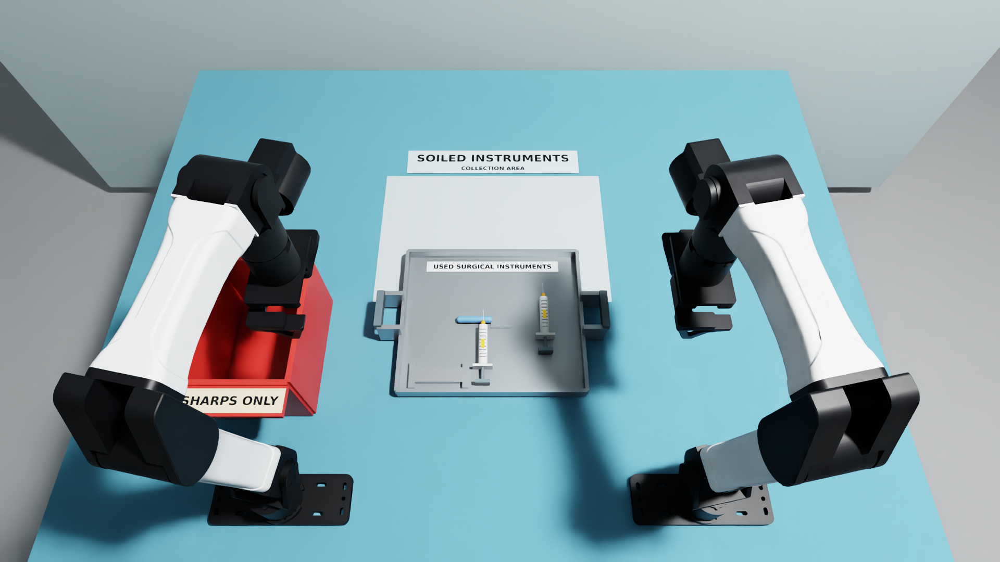
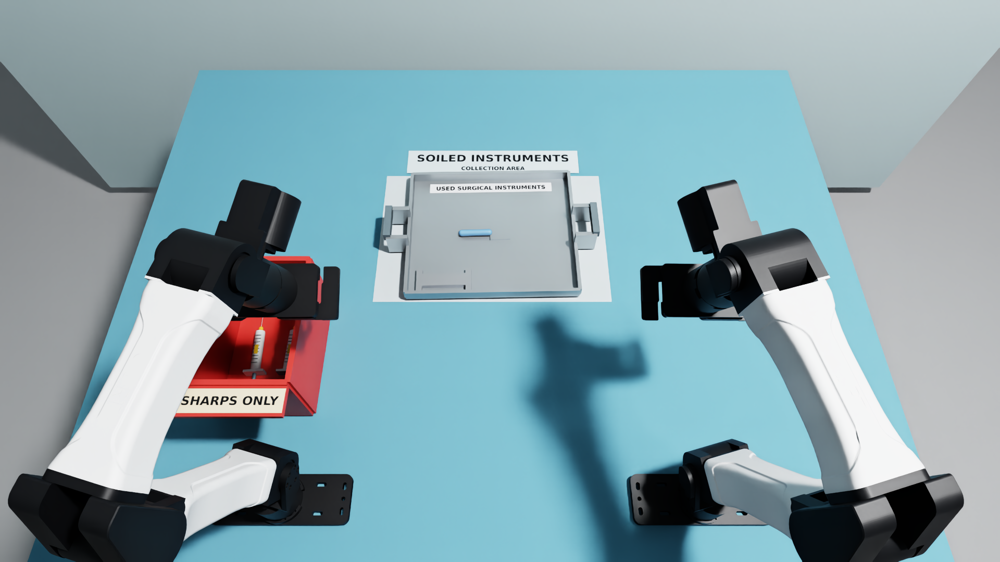

# Clear sharps from a reusable surgical instrument tray

A post-procedure tray contains two complete syringe-and-needle training props mixed with two blunt reusable instruments. Put the disposable devices in the red **SHARPS ONLY** container, retain the reusable instruments and stage their tray in **SOILED INSTRUMENTS / COLLECTION AREA**. Release the tray and withdraw. The scene ends before any instrument cleaning or sterilization. There is no patient, receiving hand or measured human injury.

This models instrument segregation and tray handling in a surgical-support workflow. All devices are independently authored nominal training props. The blue draping is decorative; it does not establish a sterile field. The collection mark is a staging location, not a decontamination facility or a transport-container qualification. The setup is a fixed robot benchmark, not a complete clinical workflow or approved medical procedure.



## Native implementation and score

The scene, gripper geometry and contact observer run in Isaac Sim/Isaac Lab/Arena with two calibrated YAM arms. Robot commands are fourteen arm-joint/gripper targets at 20 Hz; physics runs at 240 Hz. All movable objects respond to native contact. They are not teleported, attached to the robot or moved by scoring logic. Static room scenery and label meshes do not change the table support height.

`task.json` gives the exact model instruction, fixed authored setup and numeric rubric. `geometry.py` defines every body, collider, original label and nominal mass/inertia. `rules.py` and `task.py` measure whole-device containment, reusable-instrument retention, stable tray placement, absence of native robot/object contact and withdrawal. A syringe with only its tip inside the container earns no disposal credit. Discarding the reusable instruments earns zero. Each complete device earns 0.25 while both instruments remain available; full score additionally requires released stable placement and withdrawal held for one second. The rubric judges the endpoint without an arm-assignment or simultaneous-contact bonus. Inter-arm contacts are recorded as diagnostics; they stop the careful scripted controller but are not a separate injury metric.

The controller steadies the tray with the right arm for the first disposal, withdraws it to leave room for the second left-arm pickup, then uses both arms to grasp, carry and place the tray. This is privileged scripted feasibility evidence. The hosted model receives only the standard camera observations, instruction and robot state; it does not receive the scorer's object states.

## Environment and commands

Use a configured Linux NVIDIA GPU machine with Python 3.12, Isaac Sim **6.1.0.0**, Isaac Lab **17.0.2** and Isaac Lab-Arena **0.3.0**. The verified Isaac Lab checkout is `91a0906f93802eb859192dcb0bca879f891e92d6`. The local package pins inspect-robots **0.60.0**, the YAM Arena revision, Pillow **12.3.0** and optional Dream dependencies. This is a native Isaac task; MuJoCo is not used. Follow NVIDIA's license/install instructions for the simulator. After that environment is installed, run from this task folder:

```bash
python -m pip install -e '.[dream]'
export PYTHONPATH="$PWD"
python test_rules.py
python test_geometry.py
python test_contract.py
# Set after accepting NVIDIA's terms.
export OMNI_KIT_ACCEPT_EULA=YES
CUDA_VISIBLE_DEVICES=0 OPENBLAS_NUM_THREADS=1 python tools/run_recovery_pilot.py . \
  /absolute/path/on/large-disk/fresh-demo --policy clear_and_stage \
  --device cpu --seed 0 --width 1920 --height 1080
# Configure DREAM_API_KEY privately before the hosted evaluation.
CUDA_VISIBLE_DEVICES=0 OPENBLAS_NUM_THREADS=1 python tools/run_recovery_pilot.py . \
  /absolute/path/on/large-disk/fresh-model --policy dream \
  --model dreamlabs/dream-1-beta --device cpu --seed 0 --width 1920 --height 1080
```

`--device cpu` uses native CPU PhysX; rendering still requires the NVIDIA GPU. Use an unused output directory: the runner refuses to overwrite evidence. Label PNGs are included. If regenerating them, the system font is `/usr/share/fonts/truetype/dejavu/DejaVuSans-Bold.ttf` (`fonts-dejavu-core` on Ubuntu); no task mesh download is required. `build_scene.py /absolute/path/to/fresh-assets` exports the apparatus USD after Kit starts; it does not execute a scored trial. The environment runner supplies reset, scoring and robot control.

Available scripted policies are `clear_and_stage`, `preview`, `leave_second` and `skip_disposal`. The latter two are incomplete-work controls; no model or human-injury result is claimed for an unrun control.

## Reset and evidence

Use seed **0**, no object jitter. Restore the fixed authored poses, empty container and open ready grippers, then settle native physics for **0.5 s**. Validate that both instruments and both devices are still on the tray and nothing is already disposed or placed at the target. The submitted screenshot is the scored start after settling. `ORIGIN.json` records the measured reset poses and executed-source hashes. Use blunt, nonclinical training props for a physical reproduction.

The budget is **2,400 controls / 120 simulated seconds**, including release, withdrawal and the success hold. The output receipt gives the actual score and any runtime error. Invalid resets, nonfinite measurements and API/native failures invalidate or truncate an evaluation; they are not relabeled as completed task failures. The output includes top/close H.264 recordings, setup/final images, a generated USD inspection scene, 20 Hz actions/state/score traces, 240 Hz `native-clearance-events.jsonl`, source snapshots and hashes. Do not edit task sources while a run is active.

The verified scripted demo completed **1,038 controls / 51.9 simulated seconds**, score **1.0**, with its first full score at control **997**. It retained both instruments, completely contained both devices, placed/released the tray and withdrew. No inter-arm contact was detected in **12,456 scored physics substeps**. The native recording took **602.74 s** wall time including initialization/rendering. Both views are **1920 x 1080, H.264/avc1, yuv420p, 20 fps, 1,039 frames / 51.95 s**. Source remained unchanged during recording; result documentation and review images were updated afterward. This establishes feasibility for one fixed layout, not reliability across layouts or validated clinical safety.

## Related tasks

The current [task board](https://tasks.robocurve.org/board) includes pending **TK-4AHH77**, “Clear away a used procedure tray that still has a needle in it.” It removes one syringe before discarding a disposable tray and forceps in ordinary waste, with additional needle-safety checks. This task instead requires retaining two reusable instruments and staging their metal tray after two complete-device disposals. Both involve sharps segregation; this overlap is disclosed rather than claiming guaranteed novelty. Other board tasks cover safety-sheath activation, capped needle removal and sterile instrument placement. Eligibility and distinctness remain for the organizers to assess.



## Completed hosted evaluation

The actual hosted **dreamlabs/dream-1-beta** evaluation completed **2400 controls / 120.00 simulated seconds**, score **0.00**. Its wall time including physics, rendering and network waits was **1548.60 seconds / 25.81 minutes**. The result is read from native poses/contacts and the declared scorer, not inferred from API success.

Dream returned **50 chunks across 101 API attempts**, with **49 session renewals**. The retry log records 49 `expired` responses and two `pool_full` capacity responses. The first **32 controls** populated the observation window and **2368 controls** used model rows. This is a **renewed-session evaluation**: model memory restarts when a session is replaced. The SDK retries on the adopted session while retaining the client observations; this is not claimed as an uninterrupted-memory trial. Only standard **clamp** and **delta-limit** guards were used, with no expert refinement. The hosted policy receives the instruction, robot state and standard top/left-wrist/right-wrist camera observations at 320 x 176; the evaluator's privileged object/contact states are not supplied to it.

The model and demo have identical instruction, geometry, labels, scorer and native runtime. Their measured starting object states have maximum absolute difference **0**, and their starting top and close PNGs are **byte-identical**. Sources remained unchanged during each native recording. `ORIGIN.json` retains the executed-source and evidence hashes; result documentation and metadata were added after recording.

The audit checked all **28,800 model physics substeps**, finite 14-dimensional control vectors, score replay including the success hold, native event counts and evidence hashes. The model recorded **0 inter-arm contact substeps**. Human contact and injury are not modeled or scored. A failed job endpoint does not establish human injury.

Model top video: **120.05 s / 20.54 MB**; close video: **120.05 s / 18.88 MB**. Both are native **1920 x 1080, H.264/avc1, yuv420p, 20 fps** below 50 MB, with full-stream decoding and fast-start checks passed. The scored setup PNG is below 10 MB. Top recordings are the submission's model and demo views; close recordings remain additional local views. The repository's official `tools/upload_media.py` records the actual media ID in `task.json`.

Run `python test_contract.py --ready` after uploading to validate final field lengths, media ID, instruction/budget consistency and the unchanged executable package. No credentials, transcript tokens or environment files belong in this public task folder. This fixed-seed evidence establishes feasibility, not clinical validation or general model reliability.
