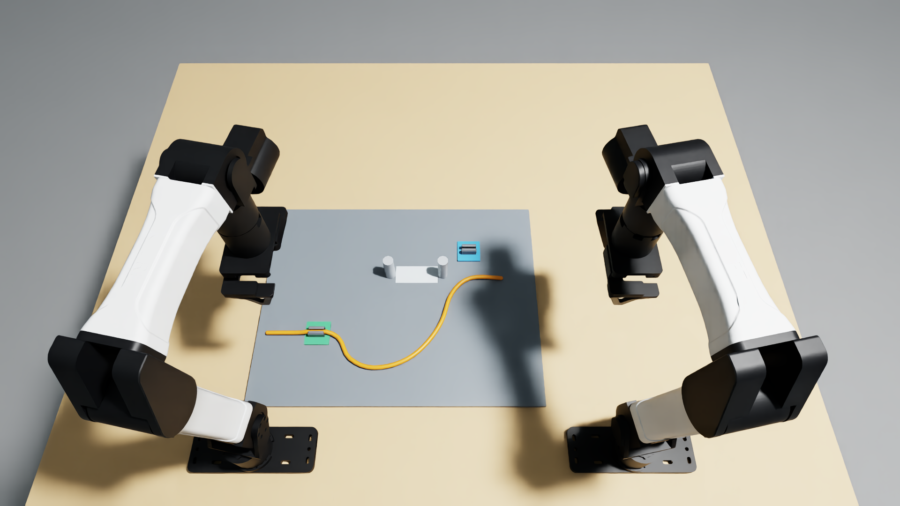
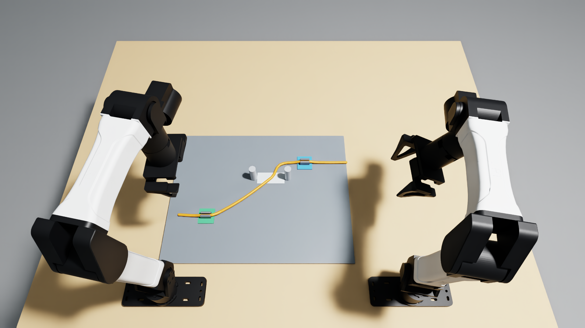

# Route a cable between two posts and secure its final clip

Use both grippers to preserve the existing green cable fixing, route the connected orange span through the marked gap, and seat it in the blue clip. Release both hands and withdraw. The finished span must lie between the posts below their tops; an unrelated loop or free tail cannot satisfy routing.



## Scene and assets

`task.json` contains the exact model instruction, fixed layout, numeric scorer, action budget and fidelity limitations. `geometry.py` generates the plate, posts, wire and clips from USD primitives. All task assets and the MIT license are included; no task mesh or texture downloads are needed. Robot and calibrated station assets come from the pinned YAM dependency.

Two YAM arms work over a fixed 400 x 510 x 8 mm plate. The two 20 mm diameter, 55 mm high metal posts leave an 80 mm opening. A painted stripe marks that passage without a collider. The 8 mm orange wire is a 46-capsule passive chain, approximately 545 mm in centreline length and 87.2 g. Its initial slack loop is upstream of the gate, with the wire already retained in the green clip and the blue clip empty. Each clip has a fixed housing and two passive spring-driven sliding jaws with rounded retaining lips. Exact dimensions, masses, poses, bend/jaw springs and contact parameters are in `geometry.py`.

This represents maintaining an existing cable fixing while installing the next fixing in a constrained route. It measures retention and connected-span routing, rather than electrical connection or manufacturing strain limits. The wire's articulated rigid links approximate bending; axial twist is locked. Flexible clip arms are approximated by sliding jaws. Friction, stiffness, damping and masses are nominal and uncalibrated; conductor strain, wear, insulation damage and electrical behaviour are omitted.

## Scoring

The native scorer and geometric predicates are in `task.py` and `rules.py`. The revised participation rule accepts sequential handling and contact anywhere on the wire; no simultaneous-contact or over-clip contact requirement remains.

- Any upstream release or wire-joint separation over 3 mm permanently gives zero. Native retention is checked at every 240 Hz physics substep. Missing or invalid native measurements invalidate the run.
- Partial credit **0.5** requires correct connected-span routing and blue-clip alignment, independently of gripper participation.
- Full credit **1.0** additionally requires each arm to have accumulated at least **0.2 seconds of fingertip/wire contact** during the scored trial. Each arm's time is counted independently at 240 Hz, on any wire link and at any location; contact intervals may be interrupted and the arms may handle the wire sequentially. Reset/warmup contact does not count. Both clips must be seated, with no robot/wire contact, both TCPs more than 70 mm from every wire-link centre and every link moving below 30 mm/s. Hold the complete conditions for 40 controls / 2 seconds.

Routing considers only the ordered material span from the first seated green crossing to the following aligned/seated blue crossing. At least one crossing of x=320 mm is required; every crossing must have its centreline at y=14..86 mm and height 3..51 mm above the plate. Passing above a post earlier is allowed; the endpoint route counts. A clip is seated when its mid-plane crossing has x offset below 2 mm and height 4..12 mm above its base. Full blue-alignment, upstream-capture and participation bounds are stated in `task.json`.

The runtime holds the latest partial score while accumulating full-score hold time. A correct route handled by only one arm earns 0.5 rather than zero. Two-arm participation is explicitly required for full credit; the task does not claim that every one-arm strategy is physically impossible. Per-arm accumulated contact seconds and completion are exposed in native metrics and substep evidence. Inter-arm and robot/post touches are recorded at every physics substep as additional diagnostics. They are not extra zero-score conditions. The careful scripted controller aborts on either diagnostic touch.

## Run and record

Use Python 3.12 in a configured Isaac Sim 6.1.0.0 / Isaac Lab 17.0.2 / Isaac Lab-Arena 0.3.0 environment with an RTX GPU. The recorded Isaac Lab source revision is `91a0906f93802eb859192dcb0bca879f891e92d6`. `pyproject.toml` pins Inspect Robots 0.60.0, the YAM source, the optional Dream integration and Dream Labs client 1.1.3.

From this task folder:

```bash
python -m pip install -e '.[dream]'
export PYTHONPATH="$PWD"
python test_geometry.py
python test_rules.py
python test_contract.py

# Set only after accepting NVIDIA's license terms.
export OMNI_KIT_ACCEPT_EULA=YES

# Full careful feasibility controller; no hosted inference.
OPENBLAS_NUM_THREADS=1 python tools/run_recovery_pilot.py . \
  /absolute/path/on/nvme/fresh-demo --policy feed_and_clip \
  --device cpu --seed 0 --width 1920 --height 1080

# Configure DREAM_API_KEY privately in the environment before this command.
OPENBLAS_NUM_THREADS=1 python tools/run_recovery_pilot.py . \
  /absolute/path/on/nvme/fresh-dream --policy dream \
  --model dreamlabs/dream-1-beta --device cpu --seed 0 \
  --width 1920 --height 1080
```

Use fresh output directories outside the source folder, preferably on NVMe. Select an available rendering GPU with `CUDA_VISIBLE_DEVICES`. `--device cpu` uses native CPU PhysX; rendering still uses RTX. Physics is 240 Hz, controls and video 20 Hz. Reset settles 0.5 seconds before scoring. Seed 0 has no jitter. The common limit is **1,200 controls / 60 simulated seconds**, including Dream camera-window preroll and the 2-second success hold. The scripted controller continues through withdrawal and final observation.

Dream receives only the exact instruction, standard top/left-wrist/right-wrist images at 320 x 176, and the measured 14-D robot state. The independent close camera is recorded for inspection and is not a fourth model input. Native top and close cameras record at 1920 x 1080; wrist renders are capped at 640 x 360 before model preprocessing. Standard Inspect Robots clamp and delta-limit guards apply; no expert action refinement or privileged task-object state is supplied to Dream. Hosted session initialization follows native reset.

The privileged expert emits only robot joint and gripper targets. After reset, neither controller teleports, animates, attaches or directly actuates the wire or jaws. Native contact performs grasping, routing and clipping.

Outputs include H.264/yuv420p top and close MP4s, setup/final PNGs, native generated USD assets, an inspection stage, action/state/score traces, control timing, 240 Hz contact/retention evidence, the executed source snapshot and `receipt.json`. Dream also writes a request transcript. A valid completed task failure has `status=completed` with its measured score. An API or native measurement error is an incomplete diagnostic, not a completed model failure. `source_unchanged` checks sources during each trial; avoid editing the package while running.

## Recorded feasibility and limitations

The recorded careful demo (`wire-gate-careful-final-1080p`) completed with **score 1.0**, 1,184 controls / 59.2 simulated seconds, first full score at control 1,063. Both clips remained seated after release and withdrawal. The connected span crossed the gate once at y=47.59 mm, centreline height 4.00 mm above the plate, and the final wire was stationary. All **14,208** scored physics substeps had **zero inter-arm touches, zero robot/post touches and zero unsafe wire events**. Recorded sources were unchanged.

Native execution and both 1080p recordings took **665.13 seconds / 11.09 minutes**. Each video has 1,185 frames at 20 fps / 59.25 seconds, including the starting observation. The top video is 11.85 MB and the close video 14.27 MB. Both are H.264/avc1, yuv420p, fast-start MP4 and passed full-stream decoding.

The unchanged contact observer was also qualified by a separate native deliberate-contact diagnostic: it detected 478 post-contact substeps and 836 inter-arm-contact substeps. The included geometry/rules checks cover wrong-side and over-post routing, extra bights, unrelated free tails and clip seams. Those geometric checks complement native execution; they do not establish broad physical reliability.

The careful demo's original geometry, task, rules, interaction and runtime source hashes are recorded in `ORIGIN.json`. The scoring revision changes only participation accounting and its score gate; geometry, scripted control, retention failures and runtime are unchanged. The submission runner adds exact instruction/budget checks and initializes hosted sessions after native reset. The explicit Inspect Robots dependency pin matches the previously executed version.



## Completed Dream-1 evaluation

The hosted `dreamlabs/dream-1-beta` run (`wire-gate-submission-dream1-1080p-03`) completed **1200 controls / 60.00 simulated seconds**, scoring **0.0**. Execution, recording and network waits took **807.58 seconds / 13.46 minutes**. Final metrics are retained in the native receipt; task failure is distinguished from simulator or API failure.

Dream returned **25 chunks over 49 API attempts with 24 session renewals**. The first 32 controls populated the observation window; 1168 controls used returned model rows. SDK expiry retries retained the client observation window. This is a completed renewed-session evaluation, not an uninterrupted-session baseline. No expert refinement or privileged object-state input was supplied to the model.

The native starting object states match the recorded careful demo to a maximum absolute difference of **0**. The initial top screenshot also matches its recorded image byte for byte. The original recorded runs used matching instructions, task geometry, interaction controller, mechanism, scorer and runtime. The current participation rule is a subsequent scoring revision; recorded source snapshots remain historical evidence. Executed sources were unchanged during the model run; measured result text was added afterward.

Both model recordings passed full-stream decoding, fast-start and format/size checks. Top: **60.05 seconds, 12.55 MB**. Close: **60.05 seconds, 9.40 MB**. Both are native 1920 x 1080, H.264/avc1, yuv420p at 20 fps. The setup PNG comes from this run's scored reset and is below 10 MB.

Two initial hosted attempts encountered unusably noisy native rendering and were stopped as diagnostics. Separate camera previews were used to verify clean recording. They are excluded from submitted model results. The completed run used a direct native launch with the original runtime; experimental renderer overrides were removed.

The numeric outcome and model failure/success apply to fixed seed 0; they are not a robustness estimate. The official upload script uploaded the Dream top video, careful scripted top demo and scored setup screenshot as **M-6GRHYN**, recorded in `task.json.media`. The close recordings are additional local review material. Run `python test_contract.py --ready` to check the submission metadata. Eligibility and acceptance remain for the reviewers to determine.


## Independent arm participation revision

The review identified an irrelevant simultaneous-contact-at-the-clip condition. It has been removed. Each arm now accumulates its own fingertip/wire contact duration anywhere in the scored trial; 0.2 seconds per arm qualifies for full credit, including sequential or interrupted handling. Correct aligned routing earns 0.5 even without participation. The retention failures, connected-span route, clip seating, release/clearance, speed and 2-second hold conditions are unchanged.

`test_rules.py` covers sequential handling on different wire links, interrupted contact, simultaneous contact without any clip-location predicate, one-arm partial credit, insufficient second-arm contact, fresh-trial counters, invalid duration inputs and latched unsafe zero. These are scalar-rule regressions, not simulated-physics acceptance.

The submitted recordings were rescored from their original native 240 Hz contacts and measured wire poses, with evidence hashes checked. The legacy full-score hold provides the unchanged all-link release witness for the demo; the tool refuses to infer an unavailable release. Dream remains 0.0 and the demo remains 1.0. `SCORING_REVISION.json` records contact durations and provenance. Run:

```bash
python tools/rescore_recording.py /absolute/path/to/recorded-native-output
```

No geometry, instruction, controller or media changed, so the existing uploaded videos and setup image remain applicable as M-6GRHYN. Rescoring did not invoke Dream again and is not a fresh policy trial. Original receipts and source snapshots are preserved.

Fresh native Isaac Sim/PhysX validation (`wire-gate-scoring-v2-native-01`, 320 x 180 cameras) also scored **1.0** after **1184 controls / 59.2 simulated seconds**, first success at control **1063**, with sources unchanged during execution. Runtime was **343.96 seconds / 5.73 minutes**. All **14,208 scored substeps** were checked: zero unsafe events, inter-arm contacts or robot/post contacts. Measured contact totals were **31.9875 s left / 41.3792 s right**. Both-arm participation qualified at control **348**, before the first correct route at control **781**. This is additional scorer validation, not replacement submission footage or a new Dream trial. Source hashes and native evidence hashes are recorded in `SCORING_REVISION.json`; result metadata was updated after execution.
